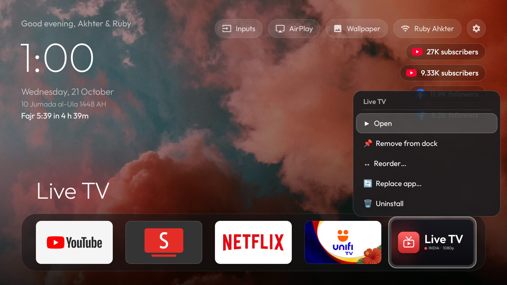
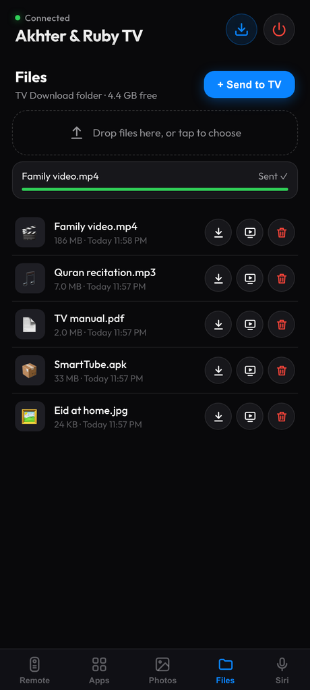
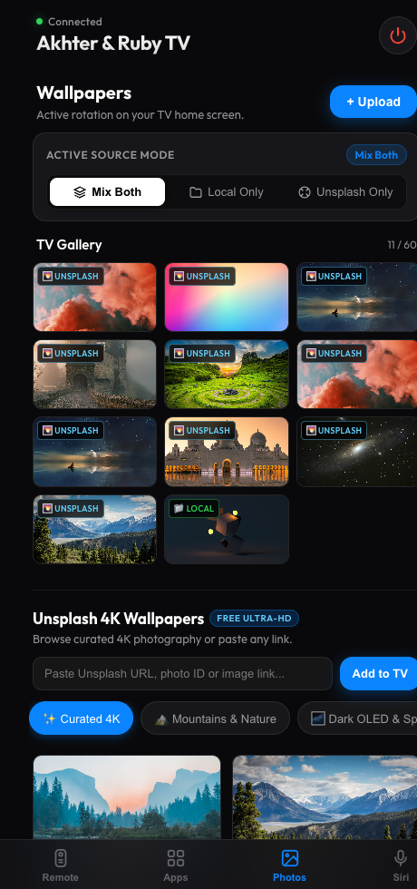

# Android TV Makeover: Akhter & Ruby TV Edition

Turn a slow, ad-filled Google TV / Android TV into a clean, Apple TV–style home screen, and get a remote for every phone and computer in the house.

**This edition adds:** Islamic prayer times for wherever the TV is (official **JAKIM** times in Malaysia), a Hijri date, a phone remote that also **sends files to and from the TV**, **AirPlay** and **Miracast** screen mirroring, live follower counters, rotating and **Unsplash 4K** wallpapers, and a 1080p **Live TV** app. Every button reacts with a press animation. It's all **reversible**.

> **Built and tested on:** Sharp AQUOS-TVW24C (MediaTek), **Android TV 14**, Malaysia firmware. The prayer-time location lookup was also tested on an Android TV emulator placed in Malaysia, Singapore, Bangladesh and the UK. It should run on most Android TV / Google TV sets (Android 9+). It does **not** run on Samsung Tizen, LG webOS or Fire TV.

> A fork of [cleanyourtv](https://github.com/Gathin23/cleanyourtv) by Gathin, by way of Kulwant Nagi's edition (both MIT). See [Credits](#-credits-and-licenses).

---

## Contents

- [Screenshots](#-screenshots)
- [What's new](#-whats-new)
- [Features](#-features)
- [Install on your TV](#-install-on-your-tv-step-by-step)
- [Phone remote](#-phone-remote)
- [Sharing files with the TV](#-sharing-files-with-the-tv)
- [Prayer times](#-prayer-times)
- [Remote cheat sheet](#-remote-cheat-sheet)
- [Privacy and network use](#-privacy-and-network-use)
- [FAQ and troubleshooting](#-faq-and-troubleshooting)
- [Undo everything](#-undo-everything)
- [For developers](#-for-developers)
- [Credits and licenses](#-credits-and-licenses)

---

## 📺 Screenshots

| Home screen (as it looks after a fresh install) |
|:---:|
|  |
| *Greeting, clock, Hijri date and next-prayer countdown on the left; Inputs, AirPlay, Wallpaper, Wi-Fi and Settings on the right, with follower counters below. Dock: YouTube, SmartTube, Live TV, MovieBox, Play Store* |

| App grid with Miracast | Long-press menu on a tile |
|:---:|:---:|
|  |  |
| *Every installed app as a 16:9 banner, including the Smart View / Miracast tile* | *Open, add or remove from the dock, reorder, replace, uninstall* |

| Phone remote | Files | Apps & inputs | Wallpapers |
|:---:|:---:|:---:|:---:|
|  |  |  |  |
| *D-pad by default, touchpad optional* | *Send, save, open and delete files* | *Launch any TV app or input* | *Pick a 4K photo and set it on the TV* |

| Live TV app | Categories |
|:---:|:---:|
|  |  |

---

## 🆕 What's new

The latest changes, all tested on the emulator first and then on the Sharp TV:

| What | Before | Now |
|---|---|---|
| **Android version target** | Built for Android 9 (API 28). Play Protect warned "built for an older version of Android" | Built for **Android 14 (API 34)**. No warning. The home screen looks and works exactly as before |
| **Button feel** | Buttons only changed colour | **Every tile, pill, menu row and dialog button presses down and springs back**, like a real button |
| **Long-press OK** | Sometimes ignored, so Remove / Reorder didn't open | Reliable. A held OK no longer closes the Inputs or Wallpaper menus either |
| **Phone remote** | Opened on the touchpad | **D-pad by default**; the touchpad is one tap away and your phone remembers the choice |
| **File sharing** | Not possible | New **Files** tab: send files of any size to the TV, save the TV's files, open them on the TV, delete them |
| **Prayer times** | Fixed to one zone | **Follow the TV's location**: JAKIM's official times for its zone anywhere in Malaysia, the local authority's times elsewhere |
| **Fresh install** | Plain black home, stock dock | The home screen above: cubes wallpaper; dock with YouTube, SmartTube, Live TV, MovieBox, Play Store |
| **Preinstalled apps** | Live TV only | **SmartTube** and **MovieBox** too (optional; uninstall them like any app and they stay gone) |
| **Phone remote while the TV asks "Allow USB debugging?"** | The remote page froze | The page keeps working and keys resume once allowed |
| **Install script** | Could install to the wrong device; reinstalled apps you had removed | Stops if two devices are connected; only updates apps still on the TV |
| **Checks** | None | Unit tests, and GitHub builds and checks every push |

---

## ✨ Features

### Home screen
* **Clean, ad-free Apple TV look**: smooth D-pad navigation, Outfit font, a glow that matches the focused app's colours, a pitch-black or wallpaper background.
* **Greeting** that follows the time of day (*Good morning / afternoon / evening, Akhter & Ruby*).
* **Big clock, date and Hijri date** (*11 Jumada al-Ula 1448 AH*).
* **Next prayer with a countdown** (*Fajr 5:39 in 5 h 50m*). Click it for the whole day's timetable. See [Prayer times](#-prayer-times).
* **Follower counters** for YouTube channels, Facebook pages and Instagram accounts, refreshed every 30 minutes while the home screen is open.
* **Press animation**: anything you press with OK shrinks slightly and springs back. It follows Android's animation speed, so turning animations off in Developer options turns it off too.

### Top bar (press Up from the dock)
* 🔌 **Inputs**: HDMI ports, AV and Live TV in one small menu.
* 📺 **AirPlay**: opens the AirPlay receiver so an iPhone, iPad or Mac can mirror or play to the TV.
* 🖼️ **Wallpaper**: choose the rotation (`✨ Mix Both`, `📁 Local Only`, `🌄 Unsplash Only`), skip to the next photo, delete one, or download curated Unsplash 4K photos right on the TV.
* 📶 **Wi-Fi**: shows the network name; click to open network settings.
* ⚙️ **Settings**: the TV's own settings.

### Dock and app grid
* **Dock** of your favourite apps; press **Down** for every installed app as a 5-column grid of 16:9 banners.
* **Long-press OK** (or press **Menu**) on any tile:
  * Dock: `▶ Open`, `📌 Remove from dock`, `↔ Reorder…` (Move Left / Right / First / Last, or nudge with Left and Right), `🔄 Replace app…`, `🗑 Uninstall`.
  * Grid: `▶ Open`, `📌 Add to dock`, `🗑 Uninstall`.
* **Samsung Smart View / Miracast** tile in the grid, so Android phones and Windows PCs can cast to the TV.

### Wallpapers
* Rotate your own photos, curated **Unsplash 4K** photos, or both, fading every 30 seconds (configurable).
* Six Unsplash collections (*Mountains & Nature*, *Dark OLED & Space*, *Moody Cities*, *Ocean Waves*, *Islamic Heritage*, *Minimalist & Art*), or paste any Unsplash link.
* Send photos from your phone, frame them with pinch and drag, and set them on the TV.

### Home button that stays yours
* Google TV forces its own launcher on the Home button. A small accessibility service sends you back to this home screen when you press **Home**, double-press it, leave an app with **Back**, or **turn the TV on**.

### Phone remote (no app to install)
* Open `http://<TV-IP>:8080` on any phone, tablet or computer on the same Wi-Fi. The TV asks you to approve each new device.
* **Remote**: D-pad (or touchpad), Back, Home, Play, Menu, Mute, ±10 s, volume, power, and a search box that types straight into the TV.
* **Apps**: TV inputs and every installed app.
* **Photos**: wallpaper mode, Unsplash 4K explorer, send your own photos.
* **Files**: [send and receive files](#-sharing-files-with-the-tv).
* **Siri**: copy links for Apple Shortcuts ("Hey Siri, open YouTube on TV") and for sending YouTube videos to the TV.
* Installs as an app (PWA) on Android, iPhone, iPad, Mac, Windows and Linux.

### Apps the installer adds
* **Live TV**: a 1080p IPTV player with categories (News, Entertainment, Movies, Music, Sports…) from public playlists.
* **AirPlay Server**: an AirPlay receiver for Apple devices.
* **SmartTube**: ad-free YouTube for TVs.
* **MovieBox**: a movie and series app. Play Protect flags it; see [the note](#step-6-build-and-install-in-one-command).

The last three aren't stored in git; the installer adds them if you put their APKs in `apps/` (see Step 6). You can uninstall any of them later and they stay uninstalled.

### Optional debloat
* `./disable.sh profiles/sharp-aquos-tvw24c.txt` **disables** (never uninstalls) the Sharp's telemetry, ads tracking and unused preinstalled apps, while keeping tuner inputs, Chromecast, Miracast, Play Store and updates. Read the profile first; `./restore.sh` undoes it.

---

## 🔧 Install on your TV (step by step)

You need a computer (Mac, Windows or Linux) on the **same Wi-Fi** as the TV.

### Step 1: Turn on Developer options on the TV
1. Open **Settings** on the TV.
2. Go to **Device Preferences → About** (Android TV) or **System → About** (Google TV).
3. Select **Android TV OS build** (or **Build**) and press **OK 7 times** until it says *"You are now a developer!"*
4. Go back and open **Developer options**.
5. Turn on **USB debugging**, and **Network debugging** / **Wireless debugging** if your TV has it.

### Step 2: Find the TV's IP address
**Settings → Network & Internet →** your Wi-Fi network. Note the **IP address**, for example `192.168.0.146`.

### Step 3: Set up your computer

**Mac** (Terminal):
```bash
brew install openjdk@17
brew install --cask android-commandlinetools
brew install android-platform-tools
```

**Windows**:
1. Install [Git for Windows](https://gitforwindows.org/) and use **Git Bash** for the commands below.
2. Install [Java JDK 17](https://adoptium.net/).
3. Download [Android Platform-Tools](https://developer.android.com/tools/releases/platform-tools), unzip it, and add the folder to your PATH.

**Linux (Ubuntu / Debian)**:
```bash
sudo apt update && sudo apt install openjdk-17-jdk adb git
```

### Step 4: Get this project
```bash
git clone https://github.com/arakaneserohingya/ahkter-tv-remake.git
cd ahkter-tv-remake
```

### Step 5: Connect to the TV
```bash
adb connect 192.168.0.146:5555     # your TV's IP from Step 2
adb devices                        # the TV should show as "device"
```
The TV shows **"Allow USB debugging?"**. Tick **Always allow from this computer** and press **OK**.

> If macOS blocks `adb`, run `./setup.sh` and `tools/find-tv.sh` once. The install script then uses `tools/tv` by itself.

### Step 6: Build and install in one command
```bash
./build_and_install.sh
```

What it does:
1. Builds the launcher and installs it.
2. Installs **Live TV**. (The launcher also installs it by itself on first start. If you uninstall it, it stays gone; **Inputs → Live TV** brings it back.)
3. Installs **AirPlay Server** if `apps/airplay/airplay-release.apk` is there. Get it from [F-Droid](https://f-droid.org/packages/io.github.jqssun.airplay/) or [GitHub](https://github.com/jqssun/android-airplay-server) and save it under that name.
4. Installs **SmartTube** and **MovieBox** if `apps/smarttube/smarttube.apk` and `apps/moviebox/moviebox.apk` are there. Get SmartTube from [its GitHub page](https://github.com/yuliskov/SmartTube). For MovieBox, copy the APK from a TV that has it (`adb shell pm path com.community.mbox.tv`, then `adb pull` that path).
5. Grants the permissions the launcher needs: location (for the Wi-Fi name and prayer times), drawing over apps (pairing prompts), notifications (the remote's background service), file access (the Files tab) and app installs (APKs from the Files tab).
6. Sets the launcher as the home app and turns on the Home button service.

The TV switches to the new home screen straight away.

> **Play Protect on a new TV.** Google may ask before installing **MovieBox** ("Harmful app blocked"): choose **Install anyway** to keep it or **Got it** to skip it. The script carries on either way. The launcher itself no longer gets a warning now that it targets Android 14.
>
> **Running it again** updates the apps that are still on the TV. It never reinstalls one you removed.
>
> **Two devices connected** (say, the TV and an emulator)? The script stops and asks which one:
> `DEVICE_ID=192.168.0.146:5555 ./build_and_install.sh`

### Step 7 (optional): Make it yours
Edit `launcher/app/src/main/res/values/config.xml`, then run `./build_and_install.sh` again.

```xml
<!-- Name in the greeting. Write & as &amp; -->
<string name="greeting_name">Akhter &amp; Ruby</string>

<!-- Dock apps, left to right, by package name. Missing apps are skipped -->
<string-array name="dock_packages">
    <item>com.google.android.youtube.tv</item>
    <item>org.smarttube.stable</item>
    <item>com.nk.live_tv</item>
    <item>com.community.mbox.tv</item>
    <item>com.android.vending</item>
</string-array>

<!-- Apps per row, 3 to 6 -->
<integer name="columns">5</integer>

<!-- Apps never shown in the grid -->
<string-array name="hidden_packages">...</string-array>

<!-- Follower counters: YouTube handles, Facebook pages, Instagram usernames -->
<string-array name="youtube_channels">
    <item>@akhterhusin_rkb</item>
    <item>@rubyahkterchth</item>
</string-array>
<string-array name="facebook_pages">
    <item>ahkter.husin</item>
    <item>RohingyaSongs</item>
</string-array>
<string-array name="instagram_users"></string-array>

<!-- Wallpaper: false = pitch black. Seconds between photos. Source: both, local or unsplash -->
<bool name="use_wallpaper">true</bool>
<integer name="wallpaper_seconds">30</integer>
<string name="wallpaper_source">both</string>

<!-- Prayer times: leave empty to follow the TV's location (recommended).
     Type a JAKIM zone code (JHR02, WLY01, SGR01...) only if the TV gets its location wrong, e.g. behind a VPN -->
<string name="prayer_zone"></string>
```

Your own wallpapers go in `launcher/app/src/main/res/drawable-nodpi/` as `wallpaper_1.jpg`, `wallpaper_2.jpg`, … (1280×720).

> **Finding an app's package name:** `adb shell pm list packages -3`, or the **Apps** tab of the phone remote.

---

## 📱 Phone remote

1. Connect your phone to the same Wi-Fi as the TV.
2. Open `http://<TV-IP>:8080` in Safari or Chrome (for example `http://192.168.0.146:8080`).
3. Tap **Pair with TV**. The TV asks *"Allow this phone to control the TV?"*: press **Right**, then **OK** on the TV remote.
4. Install it as an app:
   * **iPhone / iPad (Safari):** Share → **Add to Home Screen**.
   * **Android (Chrome):** ⋮ → **Add to Home screen**. **Samsung Internet:** ≡ → **Add page to → Home screen**.
   * **Mac:** the install icon in Chrome / Edge's address bar, or **File → Add to Dock…** in Safari.
   * **Windows / Linux:** the install icon in Chrome or Edge.
   * Or tap the **⤓** button at the top of the remote.

Pairing is per device. **Siri → Unpair This Phone** removes it.

---

## 📂 Sharing files with the TV

Open the **Files** tab on the phone remote, from a phone or a computer's browser (same address, paired the same way). Files live in the TV's **Download** folder.

* **+ Send to TV**: pick files, or drag them onto the page on a computer. Any type and any size (videos, photos, APKs, documents). Each file shows its progress, and the TV says "Received …" when it's done.
* **⬇ Save**: download a file from the TV, including files other TV apps saved in Download.
* **▶ Open on TV**: opens the file in a TV app that handles it (photos, video, music, PDF…). An **APK** opens the TV's installer, so this is an easy way to install apps. If no TV app opens that type, the page says so; a player like VLC covers most media.
* **🗑 Delete**: removes the file from the TV.

The TV keeps at least 100 MB free and refuses a file that wouldn't fit. A file with the same name as one already there is saved as a numbered copy. Half-sent files never appear in the list.

---

## 🕌 Prayer times

The TV works out where it is and shows the right times for that place, every day:

1. **Where the TV is:** the TV's own location (Android TVs find it from nearby Wi-Fi networks). If location is off, the TV's internet address.
2. **In Malaysia:** the **official JAKIM e-Solat times** for the zone the TV is in (JHR02 for Johor Bahru, WLY01 for Kuala Lumpur, SGR01 for Gombak / Petaling…). If e-Solat is down, the same place calculated with JAKIM's method.
3. **Anywhere else:** the local authority's method for that country (for example MUIS in Singapore, Umm al-Qura in Saudi Arabia), via Aladhan.
4. Times refresh daily and whenever the TV moves. If the internet is down, the last times stay up and it tries again every 15 minutes.

The Hijri date comes with the times. Click the prayer line on the home screen for the full timetable.

If the TV is behind a VPN (so it seems to be somewhere else), type your JAKIM zone into `prayer_zone` in `config.xml`.

---

## 🎮 Remote cheat sheet

| To… | Press on the TV remote |
|---|---|
| Move around | **Arrows** |
| Open an app | **OK** |
| Top bar (Inputs, AirPlay, Wallpaper, Wi-Fi, Settings) | **Up** from the dock |
| All apps | **Down** from the dock |
| Tile menu (open, dock, reorder, replace, uninstall) | **Hold OK**, or press **Menu** |
| Move a dock tile while reordering | **Left / Right** |
| Full prayer timetable | **OK** on the prayer line |
| Cast from Android / Windows | **Miracast (Smart View)** tile in the grid |
| Mirror from iPhone / Mac | **AirPlay** in the top bar |

---

## 🔒 Privacy and network use

No accounts, no ads, no analytics. Nothing is sent anywhere except the requests below.

**From the TV (launcher):**

| Service | Why | What it sees |
|---|---|---|
| [solat.my](https://solat.my) | Which JAKIM zone the TV is in | Coordinates rounded to about 1 km |
| [e-solat.gov.my](https://www.e-solat.gov.my) | Malaysia's official prayer times | The zone code |
| [api.aladhan.com](https://aladhan.com/prayer-times-api) | Prayer times outside Malaysia, or when e-Solat is down | Coordinates rounded to about 1 km |
| [ipwho.is](https://ipwho.is), then [ip-api.com](https://ip-api.com) | Rough location, only when the TV's own location is off | The TV's internet address |
| Android's geocoder | City name for the prayer line | The TV's location (Android's own service) |
| youtube.com, facebook.com, instagram.com | Follower counts, every 30 minutes | Public pages of the accounts in `config.xml` |
| images.unsplash.com | Only when you pick an Unsplash wallpaper | Which photo |

**From your phone's browser (remote page):** Google Fonts for the font, and Unsplash photo previews in the Photos tab.

**On your home network only:**
* The phone remote and the Files tab are served by the TV on port **8080**. Only devices you approve on the TV can use it, and files go straight between your phone and the TV. It is plain HTTP, like most things on a home network, so use it on a Wi-Fi you trust.
* The launcher presses remote keys for the phone remote through the TV's own network debugging (ADB on port 5555), which stays on. Any new computer that connects to it must be approved on the TV screen first.

**Other apps:** Live TV streams public channels listed by [iptv-org](https://github.com/iptv-org/iptv). AirPlay Server, SmartTube and MovieBox are separate apps with their own behaviour; MovieBox is flagged by Play Protect, so skip it if you're unsure.

---

## ❓ FAQ and troubleshooting

**Pressing Home or turning the TV on briefly shows Google TV.**
Google TV firmware sends Home to its own launcher. The Home button service switches back right away. If it stops after a firmware update:
```bash
adb shell settings put secure enabled_accessibility_services com.kulwant.atvhome/.HomeInterceptService
adb shell settings put secure accessibility_enabled 1
```

**The prayer times are for the wrong place.**
Turn on location in the TV's settings, or set `prayer_zone` in `config.xml` (see [Prayer times](#-prayer-times)).

**The Wi-Fi pill doesn't show the network name.**
Android only gives apps the Wi-Fi name with location permission:
```bash
adb shell pm grant com.kulwant.atvhome android.permission.ACCESS_FINE_LOCATION
```

**The Files tab says "File sharing is off on the TV".**
Run `./build_and_install.sh` again, or:
```bash
adb shell appops set com.kulwant.atvhome MANAGE_EXTERNAL_STORAGE allow
```

**The phone remote's keys stopped working.**
Look at the TV: it's probably asking **"Allow USB debugging?"**. Tick **Always allow** and press **OK**. Also check that Network debugging is still on in Developer options.

**Chrome on Android says "This app cannot be installed, but can create shortcut".**
Chrome only makes full app installs for HTTPS sites, and the TV serves the remote over local HTTP. **Create shortcut** works the same: it opens full screen without the address bar. To get the real install prompt: open `chrome://flags/#unsafely-treat-insecure-origin-as-secure`, add `http://<TV-IP>:8080`, set it to **Enabled** and relaunch Chrome. Samsung Internet installs it without this.

**ADB says "failed to connect" or "Connection refused".**
Check both devices are on the same Wi-Fi (not a guest network) and debugging is still on, then:
```bash
adb kill-server
adb connect <TV-IP>:5555
```

**ADB says "unauthorized".**
Accept **"Allow USB debugging?"** on the TV, with **Always allow from this computer** ticked.

---

## 🔙 Undo everything

```bash
# 1. Turn off the Home button service
adb shell settings put secure enabled_accessibility_services '""'
adb shell settings put secure accessibility_enabled 0

# 2. Remove the apps this project added
adb uninstall com.kulwant.atvhome
adb uninstall com.nk.live_tv
adb uninstall io.github.jqssun.airplay
adb uninstall org.smarttube.stable
adb uninstall com.community.mbox.tv

# 3. Only if you ran ./disable.sh: switch the disabled apps back on
./restore.sh profiles/<your-tv>.txt
```
The TV is back to stock. `./backup.sh` saves the TV's settings and app lists before you change anything, if you want a record.

---

## 🧑‍💻 For developers

### Project layout
| Path | What |
|---|---|
| `launcher/` | The home screen (Java, Android 9+, targets Android 14). Package `com.kulwant.atvhome` |
| `launcher/app/src/main/res/values/config.xml` | Everything you're meant to customise |
| `launcher/app/src/main/assets/phone.html` | The phone remote (one HTML file served by the TV) |
| `apps/live-tv/` | Live TV app (Flutter). Build with `./build_live_tv.sh` |
| `apps/airplay`, `apps/smarttube`, `apps/moviebox` | Where the optional APKs go (not in git) |
| `profiles/` | Debloat lists for `disable.sh` / `restore.sh` |
| `tools/` | `find-tv.sh` finds TVs on the network; `tv` is an ADB client for when macOS blocks `adb` |
| `PROMPT.md` | The prompt to rebuild all of this with an AI coding assistant |

### Checking a change
Try it on the emulator first (Android Studio → **Television 1080p**), then on the TV. These run on your computer, and GitHub runs them on every push:

```bash
(cd launcher && ./gradlew assembleDebug testDebugUnitTest)   # launcher builds, unit tests pass
(cd apps/live-tv && flutter analyze)                         # Live TV app has no issues
```

---

## 📜 Credits and licenses

* **Original project:** [cleanyourtv](https://github.com/Gathin23/cleanyourtv) by [Gathin](https://github.com/Gathin23), MIT. The launcher, debloat scripts, tools and prompt started there. This edition builds on **Kulwant Nagi**'s version of it (MIT, see [LICENSE](LICENSE)).
* **This edition:** © 2026 [Akhter Husin](https://github.com/arakaneserohingya), for a Sharp AQUOS TV in Malaysia. MIT, like the rest; see [LICENSE](LICENSE).
* **Live TV app:** fork of [kananinirav/Indian-IPTV-App](https://github.com/kananinirav/Indian-IPTV-App) (MIT). Channels from [iptv-org](https://github.com/iptv-org/iptv).
* **AirPlay receiver:** [AirPlay Server](https://github.com/jqssun/android-airplay-server) by jqssun, based on UxPlay (GPL-3.0). A separate app, not part of the launcher.
* **Prayer times:** [JAKIM e-Solat](https://www.e-solat.gov.my), [solat.my](https://solat.my) and [Aladhan](https://aladhan.com).
* **Remote key presses:** [dadb](https://github.com/mobile-dev-inc/dadb) (Apache 2.0).
* **Font:** [Outfit](https://github.com/Outfitio/Outfit-Fonts) (SIL Open Font License).
* **Wallpapers:** photos from [Unsplash](https://unsplash.com).
* App icons and trademarks belong to their owners.
