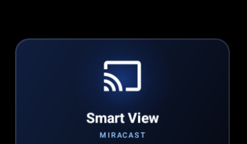

# Android TV Makeover: Akhter & Ruby TV Edition

A beginner-friendly, complete guide to transforming your Google TV or Android TV into a clean, modern Apple TV–inspired setup.

Replaces slow, ad-heavy stock launchers with an ultra-clean, ad-free interface, adds native **AirPlay** and **Samsung Smart View (Miracast)** screen mirroring, **Islamic prayer times & Hijri calendar**, **live social media subscriber counters**, a **zero-latency phone remote**, and a **1080p Live TV streaming app**.

Everything runs locally on your TV, requires under 40 MB of RAM, and is **100% reversible** at any time.

---

## 📺 Visual Showcase

| Home Screen | App Grid & Miracast |
|:---:|:---:|
|  |  |
| *Personalized greeting, Hijri calendar, prayer countdown, and glowing dock* | *Custom 16:9 banners, including Samsung Smart View / Miracast* |

| Miracast (Smart View) Tile | Phone Remote (Web App) |
|:---:|:---:|
|  | &nbsp;&nbsp; |
| *Native screen casting tile sorted cleanly under 'M'* | *Zero-install touch remote, keyboard, and app launcher at `http://<TV-IP>:8080`* |

| Live TV App | Category Sidebar |
|:---:|:---:|
|  |  |
| *Ultra-fast 1080p channel streaming* | *Organized categories with instant cache* |

---

## ✨ Features at a Glance

* **Clean Apple TV Interface**: Fluid D-pad navigation, custom Outfit typography, dynamic color-matching app glow, and an OLED pitch-black background or rotating family photo wallpapers.
* **Personalized Header**:
  * Time-aware greeting (`Good morning`, `Good afternoon`, `Good evening, Akhter & Ruby`).
  * Current date and official **Islamic Hijri Calendar** (*e.g., 9 Jumada al-Ula 1448 AH*).
  * **Accurate Prayer Times with Countdown** (*e.g., Fajr 5:39 in 6 h 34m*). Click the prayer text anytime to display a full on-screen schedule toast (Fajr, Sunrise, Dhuhr, Asr, Maghrib, Isha).
* **Quick-Access Top Pills**:
  * 🔌 **Inputs**: Switch between HDMI 1, HDMI 2, AV, and TV inputs.
  * 📺 **AirPlay**: Launches "My TV Airplay" to cast screens and music from iPhone, iPad, or Mac.
  * 📶 **Wi-Fi**: Shows current Wi-Fi name (*e.g., Ruby Akhter*); click to open Network Settings.
  * ⚙️ **Settings**: Opens standard Android / Google TV Settings.
* **Social Media Counters**: Live follower & subscriber badges for YouTube, Instagram, and Facebook.
* **Native Screen Mirroring**:
  * **Apple AirPlay**: Full screen mirroring and audio streaming.
  * **Samsung Smart View / Miracast**: Built-in Wi-Fi Display sink integration automatically styled with a custom screen cast banner and sorted under 'M' for easy launching from any Android phone or Windows PC.
* **Home Button Interception**:
  * Bypasses Google TV's forced ad launcher safely using a lightweight background accessibility service.
  * Pressing **Home**, **double-pressing Home**, exiting apps via **Back**, or **turning on the TV** always returns straight to your clean launcher without black recovery screens or errors.
* **Phone Web Remote**:
  * Open `http://<TV-IP>:8080` on any phone browser.
  * Includes a touch trackpad, volume controls, app launcher, photo slideshow uploader, and instant keyboard typing into search fields.

---

## 🛠️ Beginner Installation Guide (Step-by-Step)

Follow these simple steps to set up your TV. You only need a computer (Mac, Windows, or Linux) connected to the **same Wi-Fi network** as your TV.

### Step 1: Enable Developer Options on Your TV
1. Turn on your TV and open **Settings** (gear icon in the top right).
2. Go to:
   * **Device Preferences → About** (on Android TV), OR
   * **System → About** (on Google TV).
3. Scroll down to **Android TV OS build** (or **Build**).
4. Press the **OK / Center button on your remote 7 times**. You will see a message: *"You are now a developer!"*
5. Press the Back button once to return to the previous menu.
6. Open the newly appeared **Developer options** menu.
7. Turn **ON** these two switches:
   * ✅ **USB debugging**
   * ✅ **Wireless debugging** (or **Network debugging** if your TV shows it).

---

### Step 2: Find Your TV's IP Address
1. In your TV's **Settings**, go to **Network & Internet**.
2. Click on the Wi-Fi network you are connected to.
3. Look for the **IP address** (for example: `192.168.0.146` or `192.168.1.50`).
4. Write this IP address down—you will use it to connect from your computer.

---

### Step 3: Set Up Your Computer

Choose your computer operating system below:

#### 🍏 On Mac (macOS):
Open the **Terminal** app (press `Cmd + Space`, type `Terminal`, and press Enter).
If you don't already have Homebrew, install it, then install Java and Android tools:

```bash
# 1. Install Java 17 and Android tools
brew install openjdk@17
brew install --cask android-commandlinetools
brew install android-platform-tools
```

#### 🪟 On Windows:
1. Download and install **Git for Windows** from [git-scm.com](https://gitforwindows.org/) (use Git Bash).
2. Download and install **Java JDK 17** from [adoptium.net](https://adoptium.net/).
3. Download **Android SDK Platform-Tools (ADB)** from [developer.android.com/tools/releases/platform-tools](https://developer.android.com/tools/releases/platform-tools), extract the zip, and add the folder to your System PATH.

#### 🐧 On Linux (Ubuntu / Debian):
```bash
sudo apt update
sudo apt install openjdk-17-jdk adb git
```

---

### Step 4: Clone this Project
Open your computer's terminal and run:

```bash
git clone https://github.com/your-username/ahkter-tv-remake.git
cd ahkter-tv-remake
```

---

### Step 5: Connect Your Computer to the TV Over Wi-Fi
Replace `192.168.0.146` with your TV's actual IP address from Step 2:

```bash
adb connect 192.168.0.146:5555
```

**⚠️ IMPORTANT STEP ON YOUR TV SCREEN:**
A popup will immediately appear on your TV: **"Allow USB debugging?"**
1. Use your TV remote to tick the checkbox: **"Always allow from this computer"**.
2. Click **OK / Allow**.

Check that the connection is active:
```bash
adb devices
```
You should see your TV listed with the status `device`:
```text
List of devices attached
192.168.0.146:5555    device
```

---

### Step 6: Customize Your Settings (Optional)

Open the configuration file in any text editor:
`launcher/app/src/main/res/values/config.xml`

Here are the easy settings you can change:

```xml
<!-- 1. Your Custom Greeting Name -->
<!-- Note: If using an ampersand (&), write it as &amp; -->
<string name="greeting_name">Akhter &amp; Ruby</string>

<!-- 2. Apps on the Main Dock (left to right by package name) -->
<string-array name="dock_packages">
    <item>com.google.android.youtube.tv</item>
    <item>org.smarttube.stable</item>
    <item>com.netflix.ninja</item>
    <item>com.kulwant.livetv</item>
    <item>my.com.tm.telekom.unifitv.tv</item>
</string-array>

<!-- 3. Number of Apps Per Row (3 to 6, default is 5) -->
<integer name="columns">5</integer>

<!-- 4. Islamic Prayer Times Zone (JAKIM e-Solat official code) -->
<!-- Examples: WLY01 (Kuala Lumpur/Putrajaya), SGR01 (Gombak/PJ/Selangor), JHR02 (Johor Bahru) -->
<string name="prayer_zone">WLY01</string>

<!-- 5. Social Media Follower Counters (shown in top-right) -->
<string-array name="youtube_channels">
    <item>@akhterhusin_rkb</item>
    <item>@rubyahkterchth</item>
</string-array>
<string-array name="facebook_pages">
    <item>ahkter.husin</item>
</string-array>

<!-- 6. Background Wallpaper (true for rotating photos, false for pure pitch-black OLED) -->
<bool name="use_wallpaper">true</bool>
<integer name="wallpaper_seconds">30</integer>
```

> **💡 How to find an app's package name?**
> Run: `adb shell pm list packages -3` to see all apps you installed, or open the **Apps** tab on the phone remote.

---

### Step 7: Build and Install in One Command

Run the master install script in your terminal:

```bash
./build_and_install.sh
```

#### What this script does automatically:
1. Compiles the native launcher app.
2. Automatically copies and installs the 1080p **Live TV app**.
3. Installs and configures **My TV Airplay**.
4. Automatically grants required TV permissions (`ACCESS_COARSE_LOCATION` for Wi-Fi SSID, `SYSTEM_ALERT_WINDOW` for phone pairing).
5. **Enables the Home Interception Service** so your remote's Home button opens your clean launcher every time.

Your TV screen will immediately switch over to your new launcher!

---

## 📱 Setting Up the Phone Web Remote

No app needs to be installed on your phone. The TV hosts its own remote control web page:

1. Make sure your phone is connected to the same Wi-Fi as your TV.
2. Open Safari or Chrome on your phone and go to:
   ```text
   http://<TV-IP>:8080
   ```
   *(Example: `http://192.168.0.146:8080`)*
3. Tap the button: **"Pair with TV"**.
4. A prompt will appear on your TV screen: *"Allow this phone to control the TV?"*
   * Press **Right Arrow**, then **OK** on your physical TV remote to approve.
5. **Add to Phone Home Screen**:
   * **On iPhone**: Tap the Share icon (square with arrow) → tap **Add to Home Screen**.
   * **On Android**: Tap the three dots menu (⋮) → tap **Install App** or **Add to Home Screen**.
6. You now have an ad-free, full-screen touch remote with trackpad, live keyboard typing, and photo uploader!

---

## 🕹️ Everyday Controls & Remote Cheat-Sheet

| Action | What to Press on Physical Remote |
|---|---|
| **Navigate Tiles** | **Arrow Keys** (Left / Right / Up / Down) |
| **Open App** | **OK / Center Button** |
| **Access Top Menu** | Press **Up** from the dock row (Inputs, AirPlay, Wi-Fi, Settings) |
| **Browse All Installed Apps** | Press **Down** from the dock row to scroll into the 5-column app grid |
| **Return to Dock** | Press **Back** or press **Home** |
| **Rearrange / Change Dock Apps** | **Long-press OK** (or press the **Menu** button) on any dock icon |
| **View Full Prayer Timetable** | Click the **Time / Prayer text** in the top-left corner |
| **Screen Cast (Android/Samsung)** | Click the **Miracast (Smart View)** tile in the app grid |
| **Screen Mirror (Apple/iPhone)** | Click the **AirPlay** pill in the top menu |

---

## ❓ Frequently Asked Questions & Troubleshooting

### Q: Why does pressing Home or waking the TV briefly show Google TV?
**A:** Google TV firmware hardcodes `KEYCODE_HOME` to launch Google's ad launcher. Our built-in **HomeInterceptService** monitors window changes in real time and redirects you back to Akhter & Ruby TV Home within 80 milliseconds.

### Q: How do I re-enable the Home button redirect if it stops working?
If you updated TV firmware or restarted accessibility services, run this single command:
```bash
adb shell settings put secure enabled_accessibility_services com.kulwant.atvhome/.HomeInterceptService
adb shell settings put secure accessibility_enabled 1
```

### Q: ADB says "failed to connect" or "Connection refused"
1. Verify both your computer and TV are connected to the exact same Wi-Fi network (not guest Wi-Fi).
2. Check that **Network Debugging / USB Debugging** is still toggled **ON** in TV Developer Options.
3. Restart ADB on your computer:
   ```bash
   adb kill-server
   adb connect <TV-IP>:5555
   ```

### Q: ADB says "device unauthorized"
Look at your TV screen. A prompt asking **"Allow USB debugging?"** is waiting for your confirmation. Select **"Always allow from this computer"** and press **OK**.

### Q: The Wi-Fi pill in the top right does not show my Wi-Fi name
Android requires location permission to read Wi-Fi network names (SSID). Run:
```bash
adb shell pm grant com.kulwant.atvhome android.permission.ACCESS_COARSE_LOCATION
```

### Q: How do I completely uninstall and revert back to factory default?
If you ever want to revert everything back to stock:
```bash
# 1. Disable the accessibility service
adb shell settings put secure enabled_accessibility_services '""'
adb shell settings put secure accessibility_enabled 0

# 2. Uninstall custom apps
adb uninstall com.kulwant.atvhome
adb uninstall com.kulwant.livetv
adb uninstall io.github.jqssun.airplay
```
Your TV will immediately return to its original stock state with zero leftover modifications.

---

## 📜 Credits and Licenses

* Core Launcher code is licensed under the **MIT License**.
* **Live TV App**: Modified fork of [kananinirav/Indian-IPTV-App](https://github.com/kananinirav/Indian-IPTV-App) (MIT License). Streams sourced from public legal IPTV playlists via [iptv-org](https://github.com/iptv-org/iptv).
* **Remote Key Injection**: Powered by [dadb](https://github.com/mobile-dev-inc/dadb) (Apache 2.0).
* **Typography**: [Outfit Font Family](https://github.com/Outfitio/Outfit-Fonts) (SIL Open Font License).
* All app icons and trademarks belong to their respective owners.
