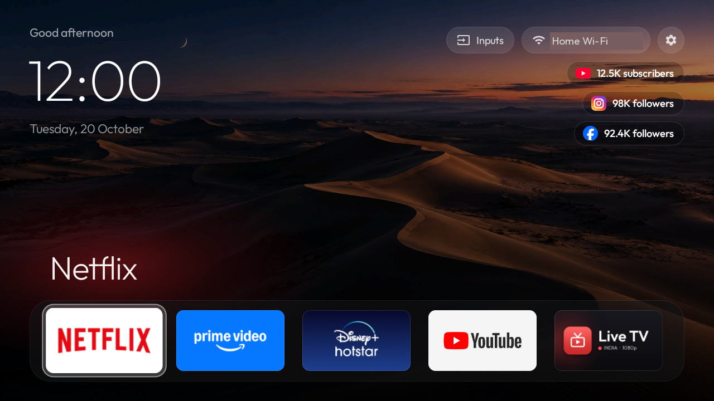
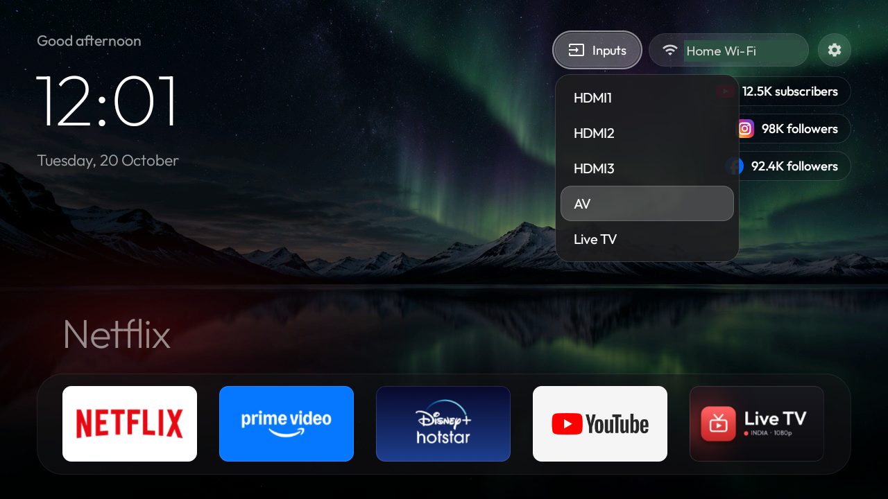
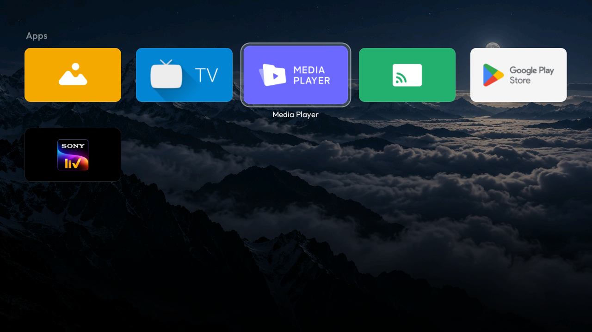
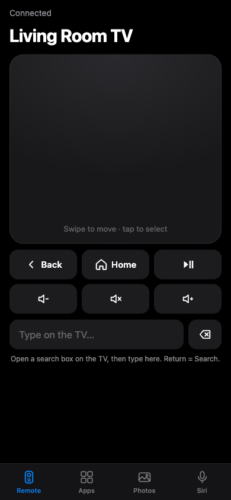
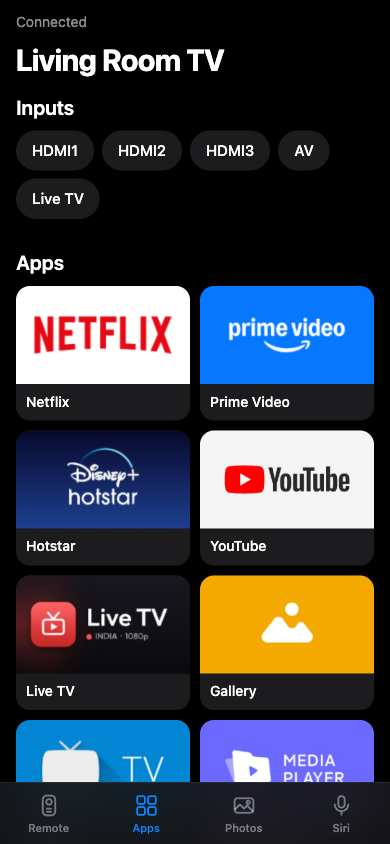

# Android TV Makeover

Debloat an Android TV over Wi-Fi, replace its ad-filled home screen with a clean Apple TV style
launcher, control it from your phone, and add a fast live TV app for Indian channels. Everything is
reversible.

- **Launcher:** your photos fading behind the home screen, a dock of 5 apps, a 5-column app grid,
  clock and greeting, YouTube / Instagram / Facebook follower counters, HDMI/AV switcher.
- **Phone remote:** a web page served by the TV. Trackpad, keyboard, volume, apps, inputs, sending
  photos to the TV, and Siri shortcuts. Works in Safari on iPhone and in any phone browser.
- **Live TV app:** Indian channels in categories, 1080p only, smooth on a 1 GB TV.

Built and tested on a Xiaomi MiTV-AXSO0 (Android TV 9, 1 GB RAM). It should work on most Android TV /
Google TV sets (Xiaomi, TCL, Hisense, Sony, OnePlus, Realme, Nvidia Shield). It does not work on
Samsung Tizen, LG webOS or Fire TV.

| Home screen | Inputs menu |
|---|---|
|  |  |

| App grid (5 per row) | Phone remote |
|---|---|
|  |   |

| Live TV app | Categories |
|---|---|
|  |  |

## What's inside

| Path | What it is |
|---|---|
| `launcher/` | Native Android TV launcher (Java, AndroidX RecyclerView, minSdk 28, ~40 MB RAM). Rotating photo wallpapers (or pitch black), a dock of five apps with a colour glow sampled from the focused app, a 5-column app grid below (the number per row is a setting), one glass focus highlight, clock and greeting in Outfit, frosted Inputs / Wi-Fi / Settings pills, follower counters, HDMI/AV/Live TV input switcher, deterministic D-pad navigation. Also runs the phone remote's web server. |
| `apps/live-tv/` | Live TV app (Flutter), a modified fork of [kananinirav/Indian-IPTV-App](https://github.com/kananinirav/Indian-IPTV-App). Category sidebar, small channel logos, 1080p streams only, instant start from cache, Up/Down channel switching, automatic backup streams. See [apps/live-tv/README.md](apps/live-tv/README.md). |
| `tools/tv` | Tiny ADB client in Python (`adb-shell`): `shell`, `screenshot`, `push`, `pull`, `key`. Works when macOS Local Network privacy blocks the stock `adb` binary. |
| `profiles/` | Debloat profiles: which packages to disable for a given TV. |
| `PROMPT.md` | The prompt to give a coding assistant (e.g. Claude Code) to do all of this on your TV, step by step, with screenshots. |

## Quick start

On the TV: Settings → Device Preferences → About → press OK on **Build** 7 times, then go back →
Developer options → turn on **USB debugging** (and Network/ADB debugging if your TV shows it).

On a Mac or Linux computer on the same Wi-Fi:

```bash
./setup.sh
```

```bash
tools/find-tv.sh
```

Accept the "Allow USB debugging?" prompt on the TV (tick "Always allow"). Then back up first:

```bash
./backup.sh
```

### 1. Debloat

Profiles list packages to disable with `pm disable-user` (nothing is uninstalled). Package names differ
between brands, so for another TV copy the profile and edit it; check what a package does with
`tools/tv shell "dumpsys package <name>"`. Never disable TV input services, the remote/Bluetooth
services, the keyboard, or Play Store/Services.

```bash
./disable.sh profiles/xiaomi-mitv-axso0.txt
```

### 2. Launcher

Edit `launcher/app/src/main/res/values/config.xml` (dock apps, hidden apps, greeting name, wallpaper),
then:

```bash
./build_and_install.sh
```

Needs JDK 17 and the Android SDK (platform 34, build-tools 34): `brew install openjdk@17` and
`brew install --cask android-commandlinetools`, then
`sdkmanager "platforms;android-34" "build-tools;34.0.0"`. If several apps claim Home, the script sets
the default with `cmd package set-home-activity`.

### 3. Live TV app (optional)

Needs Flutter (`brew install --cask flutter`):

```bash
./build_live_tv.sh
```

### Undo everything

```bash
./restore.sh profiles/xiaomi-mitv-axso0.txt --uninstall
```

Or re-enable a single app: `tools/tv shell "pm enable <package>"`.

## Phone remote

The launcher serves a control page on your home Wi-Fi at `http://<TV IP>:8080` (the IP is in
`.tv-ip` after `tools/find-tv.sh`, or in the TV's Wi-Fi settings).

1. Open it in Safari (or any phone browser) on the same Wi-Fi.
2. Tap **Pair with TV**. The TV asks "Allow this phone to control the TV?" over whatever is on
   screen: press Right, then OK on the remote. Each phone pairs once.
3. On iPhone: Share → **Add to Home Screen**, and it opens full-screen like an app.

Four tabs:

- **Remote:** a trackpad (swipe to move, tap for OK), Back, Home, play/pause, volume and mute, and a
  keyboard that types live into whatever search box is open on the TV (Return = Search).
- **Apps:** every app on the TV with its banner, plus HDMI/AV/Live TV. Tap to open.
- **Photos:** add photos from the phone and frame them (drag and pinch; dashed boxes show where the
  clock, buttons and apps sit). They fade in on the home screen straight away. Tap a photo to show it
  now, re-frame it, replace it or remove it.
- **Siri:** links to paste into the Shortcuts app ("Get Contents of URL") so "Hey Siri, Netflix on
  TV" opens apps, and one for playing a shared YouTube link on the TV.

The first time you use the Remote tab, the TV asks **Allow USB debugging?**: tick **Always allow**
and press OK. That's what lets the trackpad and keyboard press keys (see below).

**How the trackpad and keyboard work.** Android doesn't let an app press keys in other apps. The TV
already has network ADB switched on for this project, so the launcher connects to its own ADB
(`127.0.0.1:5555`, via [dadb](https://github.com/mobile-dev-inc/dadb)) and keeps one shell open. Each
key press is a single shell-builtin write of raw Linux input events to the remote control's
`/dev/input` device, so no process is started: it takes a few milliseconds instead of the ~1 s of
`input keyevent` on a slow TV. Key codes come from the remote's own key layout file, read from
`dumpsys input` at connect time, so it works on TVs whose remotes use different codes. Keys the
remote doesn't have (Enter, and on some TVs a few letters) fall back to `input keyevent` /
`input text`. See `KeyInjector.java`.

**Security.** Only paired phones can use the page, and pairing needs someone in the room: it's
approved with the TV remote, so there is no code to guess from the network ("Don't allow" is
selected first, one request at a time, a refused phone waits a minute). Paired phones get a random
token, and "Unpair this phone" revokes it on the TV. Bodies from unpaired callers are capped at 4 KB. The server only answers requests addressed to an IP, which blocks DNS-rebinding attacks
from websites. It is still plain HTTP on your home network, and the remote has the same power as
network ADB (which anyone on your Wi-Fi can already reach while it's on), so use it on a network you
trust.

## Using the launcher

- Left/Right moves along a row; Up/Down always moves exactly one row.
- Up from the dock goes to the top buttons; Down from the dock scrolls into the app grid.
- Back returns to the dock. Home while already home also returns to the dock.
- Inputs opens HDMI / AV / Live TV; it switches through Android's TV input framework.
- It remembers the last tile you were on.

## Changing the launcher

All in `launcher/app/src/main/res/values/config.xml`:

- **Dock:** `dock_packages`, package names left to right. Find one with
  `tools/tv shell "pm list packages | grep -i <name>"`.
- **Hide an app from the grid:** add it to `hidden_packages`.
- **Apps per row:** `columns` (3 to 6; 5 by default), for the dock and the grid.
- **Greeting name:** `greeting_name` (empty for just "Good evening").
- **Wallpapers:** add photos from the phone page (easiest), or put 1280×720 images named
  `wallpaper_1.jpg`, `wallpaper_2.jpg`, … in `launcher/app/src/main/res/drawable-nodpi/` before
  building. They're copied into the TV's photo store on first run and then managed from the phone.
  A `wallpaper_1_o.jpg` next to one is its full-size version, used when re-framing. These files are
  git-ignored so personal photos don't get published. `wallpaper_seconds` sets how often they change
  (30 by default); `use_wallpaper` `false` keeps the background pitch black.
- **Follower counters:** `youtube_channel`, `instagram_user`, `facebook_page`. Leave any empty to
  hide it. They're read from each profile's public page every 30 minutes (no API keys), so they can
  stop updating if a site changes its page; they then keep showing the last number.

## Troubleshooting

- **`adb` says "No route to host" on macOS although the port is open:** that's macOS Local Network
  privacy blocking the `adb` binary. `tools/tv` doesn't have that problem.
- **Home shows a chooser or the old launcher:**
  `tools/tv shell "cmd package set-home-activity com.kulwant.atvhome/.HomeActivity"`
- **The launcher crashes and Home does nothing:**
  `tools/tv shell "pm enable com.google.android.tvlauncher"`
- **The phone page doesn't load:** the phone must be on the same Wi-Fi, and the address must be the
  TV's IP, not a name. If your router gives the TV a new IP now and then, reserve one for it in the
  router's DHCP settings, or the page and Siri links stop working.
- **Pairing says the TV can't show the prompt:**
  `tools/tv shell "appops set com.kulwant.atvhome SYSTEM_ALERT_WINDOW allow"` (`build_and_install.sh`
  does this).
- **The Remote tab shows a yellow message:** accept "Allow USB debugging?" on the TV (tick Always
  allow). If network debugging was switched off, turn it back on in Developer options.
- **Gradle says everything is up to date but the APK didn't change:** build with
  `./gradlew clean assembleDebug --no-watch-fs`.
- **Gradle can't download its distribution (Java connection timeout) but curl works:** download the
  zip named in `gradle/wrapper/gradle-wrapper.properties` with curl and point `distributionUrl` at it
  with `file\:/path/to/zip`.

## Credits and licences

- Everything in this repo is MIT licensed (`LICENSE`), except the parts below, which keep their own
  licences.
- Live TV app: fork of [kananinirav/Indian-IPTV-App](https://github.com/kananinirav/Indian-IPTV-App)
  (MIT, see `apps/live-tv/LICENSE`). It's a player for public playlists from
  [iptv-org](https://github.com/iptv-org/iptv) and hosts no content.
- [dadb](https://github.com/mobile-dev-inc/dadb) (Apache 2.0), the ADB client the phone remote uses
  to press keys.
- Font: [Outfit](https://github.com/Outfitio/Outfit-Fonts), SIL Open Font License (`fonts/OFL.txt`).
- App names and logos in screenshots belong to their owners.
